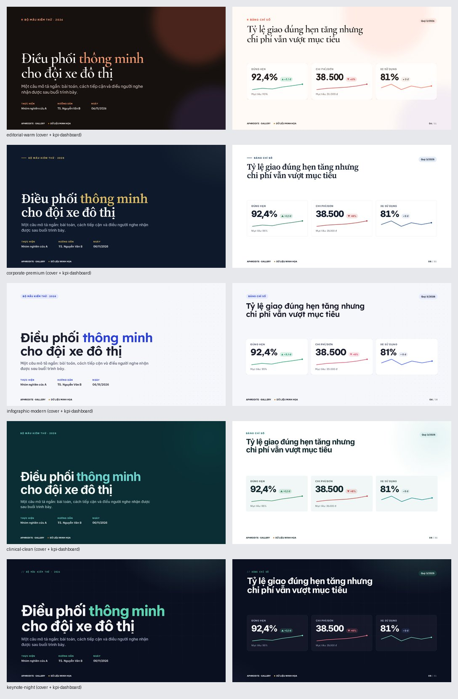

# Aphrodite-slide v2 · Personal AI Presentation Studio

A single, spec-compliant Agent Skill (`aphrodite-slide`) for consulting on, structuring, designing, animating, and exporting professional **Vietnamese, English, and bilingual** presentations — 100% local and offline-first.



## Key Capabilities

- **Single Agent Skill architecture**: `SKILL.md` is the sole skill entrypoint, with progressive-disclosure playbooks in `references/` (compatible with Claude Code, Codex, and Antigravity).
- **3-Layer Design Architecture**:
  - **5 Use-Case Templates** (with real rendered composite previews in `assets/templates/<id>/`): `academic-defense`, `lecture-teaching`, `medical-briefing`, `tech-product`, `business-review` (+ private user library in `~/.aphrodite-slide/templates`).
  - **5 Full-Token Visual Themes**: `editorial-warm`, `corporate-premium`, `infographic-modern`, `clinical-clean`, `keynote-night` (plus legacy v1 aliases `editorial-cream` and `swiss-contrast`).
  - **25 Purpose-Built Slide Layouts**: `cover`, `agenda`, `section`, `statement`, `metrics`, `kpi-dashboard`, `cards`, `process`, `timeline`, `comparison`, `problem-solution`, `table`, `chart`, `case`, `evidence-levels`, `methodology`, `diagram` (`hub` & `cycle`), `learning-objectives`, `definition`, `image-split`, `full-bleed-image`, `quote`, `key-takeaways`, `references`, `closing`.
- **Smart Recommendation Engine**: Deterministic metadata scoring (`studio.py recommend`) returning top ~3 options with real previews + custom style creation.
- **Content-First Gated Workflow**: Human-editable `outline.md` draft, anti-AI-slop & citation linter, approval baseline snapshotting, and slide-level drift/diff guard.
- **Offline Vietnamese Typography**: 7 subsetted SIL OFL `.woff2` font families bundled locally with automated Unicode glyph coverage auditing.
- **Local HTML Animation Engine**: `none`, `subtle`, `professional` (default), and `cinematic` presets with stagger choreography, SVG chart/timeline draw, number count-up, click-build steps, presenter notes/timer (`N`), overview grid (`O`), fullscreen (`F`), and `prefers-reduced-motion`.
- **Multi-Format Export & Visual QA**: Self-contained HTML (folder or `--single-file`), vector & image PDF, per-slide PNGs + contact sheet, native editable `.pptx` (native charts, native tables, speaker notes, cover-cropped images, slide transitions), and automated + visual QA (`qa-report.md`, `pptx-qa.json`).

## Quick Start

```bash
# Self-diagnostic check (requires only Python 3.10+ stdlib)
python scripts/doctor.py

# Recommend templates for a brief
python scripts/studio.py recommend --brief "Bảo vệ khóa luận tốt nghiệp về giấc ngủ sinh viên"

# Validate & build offline HTML deck (no third-party packages required)
python scripts/studio.py validate examples/gallery/deck.json --strict
python scripts/studio.py build examples/gallery/deck.json --out ./build/gallery --single-file

# Render PNGs + PDF + Visual/Motion QA (requires requirements-render.txt)
python scripts/studio.py render ./build/gallery --pdf both --strict

# Export native editable PowerPoint + structural QA (requires requirements-pptx.txt)
python scripts/studio.py pptx examples/gallery/deck.json --out ./build/gallery.pptx --qa

# Run automated test suite
python -m unittest discover -s tests -v
```

## Optional Dependencies

- **HTML Render / PDF / Visual QA**: `pip install -r requirements-render.txt` (+ local Chromium / Edge / Chrome or `playwright install chromium`).
- **Editable PowerPoint (`.pptx`)**: `pip install -r requirements-pptx.txt`.

See `references/THIRD_PARTY.md` and `LICENSE` for licensing and provenance details.
